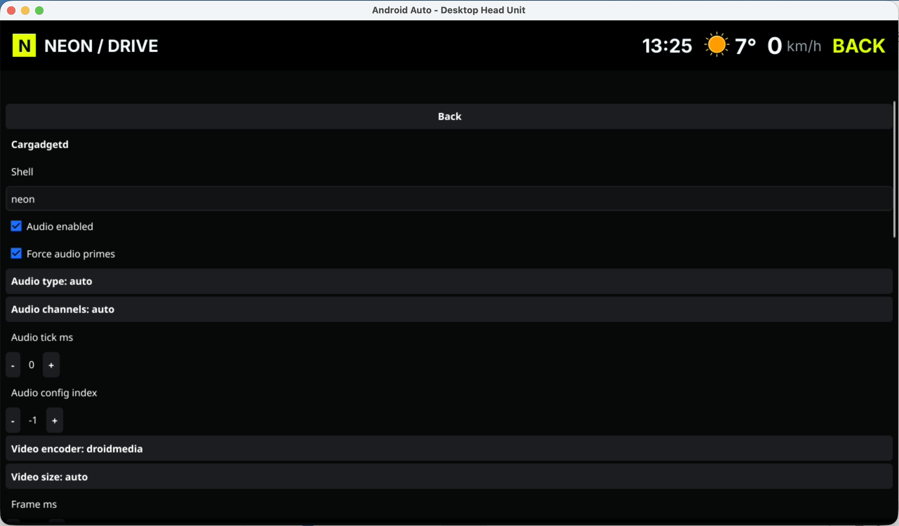
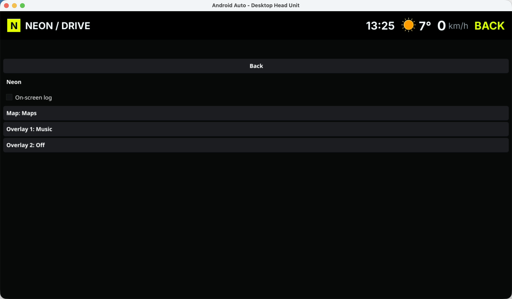
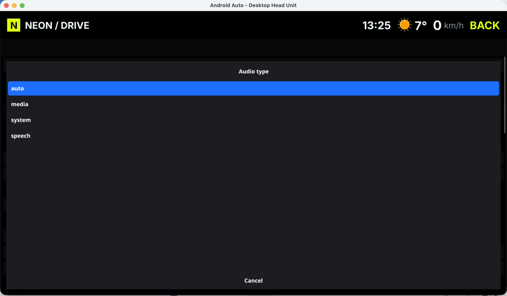
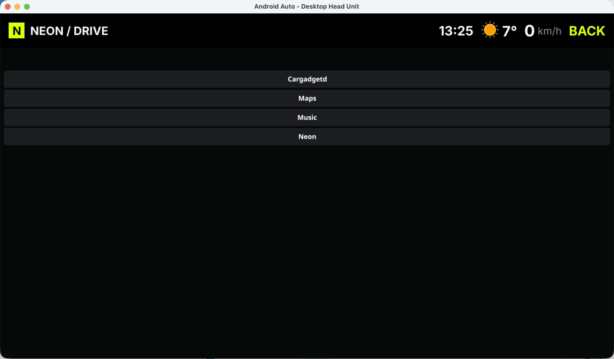

# Cargadgetd settings

Head-unit settings plugin.

Looking for cargadgetd? [Click here to go to main project repo](https://github.com/mrcyjanek/cargadgetd)

## Screenshots



|  |  |  |
|:-:|:-:|:-:|
|  |  |  |

Shell visible above: [Neon](https://github.com/MrCyjaneK/cargadgetd_shell_neon)


```bash
sfosbuild 5.1.0.11 aarch64 ./rpm/cargadgetd-settings.spec
```

<a href="https://www.flaticon.com/free-icons/settings" title="settings icons">Settings icons created by dmitri13 - Flaticon</a>
